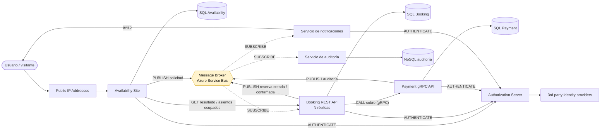
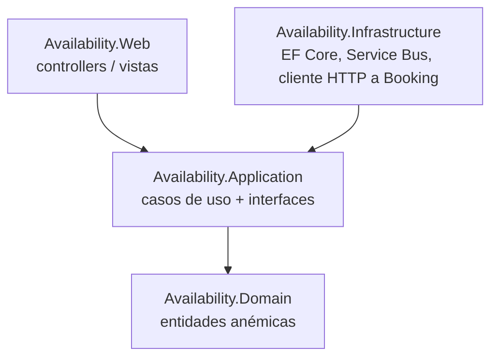
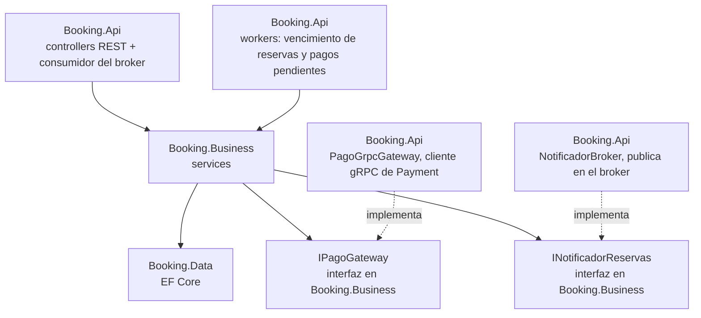
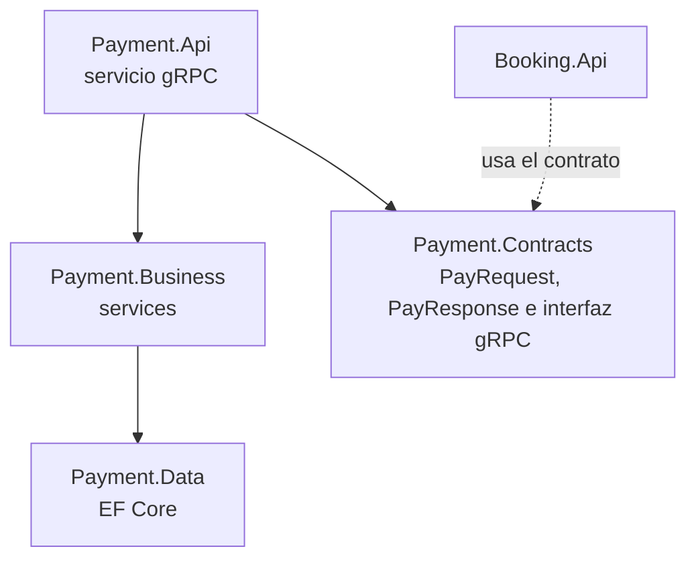
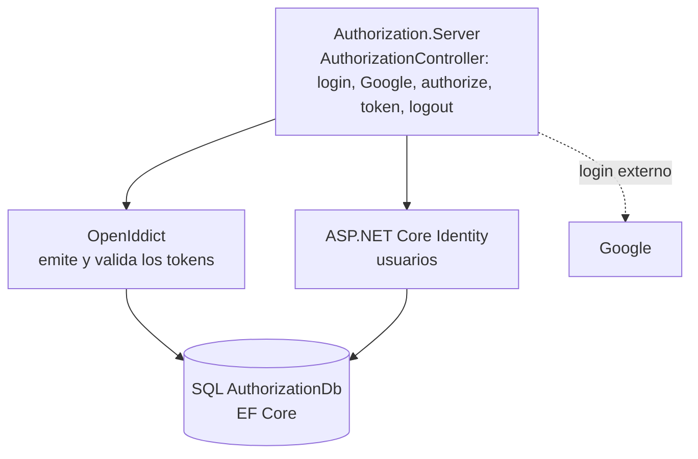
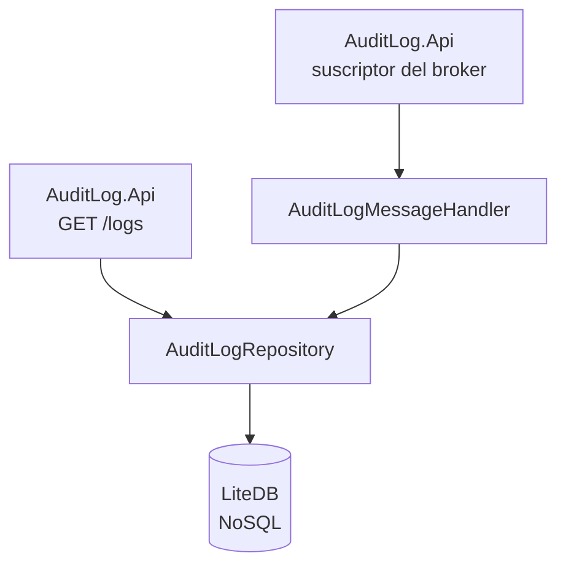
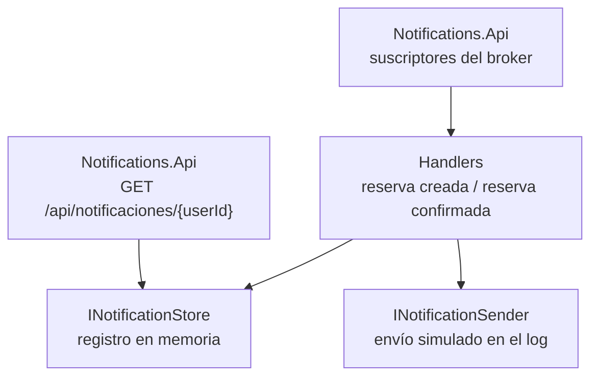

# Sistema de reserva de asientos - Grupo N° 9

Trabajo práctico de Programación IV. Sistema de reserva de asientos para eventos hecho con microservicios.

---

## Integrantes

| Integrante | Responsabilidad |
|---|---|
| Matias Huyema | Availability |
| Alex Palaversich | Availability |
| Maximiliano Diaz | Booking |
| Gianni Mozzi | Booking |
| Martin Alberto Negro Ruffino | Payment |
| Nicolás Salvador Ruiz Diaz | Authorization Server |
| Manuel Wald Katz | Message Broker |
| Alejandra Alcorta | Infraestructura e integración |
| Gianni Mozzi | Servicio de notificaciones |

---

## Diagrama de arquitectura

Es el diagrama del enunciado con los dos agregados pedidos: el **servicio de notificaciones** (punto 3h) y la marca de **dónde el sistema se vuelve eventualmente consistente** (punto 3g, en amarillo). También suma el **servicio de auditoría**, que centraliza los logs de los microservicios.

**Consistencia eventual (3g):** el sistema se vuelve eventualmente consistente en el **Message Broker**. Cuando Availability publica la solicitud, responde "solicitud recibida" sin esperar el resultado. Durante ese lapso, Availability ya registró la solicitud pero Booking todavía no creó la reserva, y el estado real del asiento se conoce recién cuando una réplica de Booking procesa el mensaje. Lo mismo pasa con la notificación al usuario, que llega después de que Booking confirma la reserva, y con los registros de auditoría, que llegan al servicio de auditoría después de que ocurre cada suceso. Los asientos ocupados que muestra Availability también pueden estar un poco atrasados: los pide a Booking por GET, y Booking puede haber procesado una reserva nueva justo después.

---

## Tabla de interpretación del diagrama (1)

| Componente | Rol | Justificación de la participación en el sistema |
|---|---|---|
| Public IP Addresses | Entrada desde Internet | Es por donde entran los usuarios. Solo Availability queda expuesto, el resto de los servicios es interno. |
| Availability Site | Sitio público (front) y entrada de las reservas | Muestra los eventos y asientos disponibles sin pedir login. Recibe la solicitud de reserva, verifica que el asiento exista, la guarda con un id único y la publica en el broker. Para el seguimiento le consulta el resultado a Booking. |
| Message Broker | Comunicación asíncrona entre servicios | Separa Availability de Booking. Availability puede responder enseguida y si Booking está caído o saturado los mensajes quedan en la cola. Las réplicas de Booking compiten por los mensajes. |
| Booking REST API | Dueño de las reservas | Decide si el asiento está libre, crea la reserva retenida, le pide el cobro a Payment y confirma o rechaza según la respuesta. También vence las reservas retenidas que no tuvieron resultado. Corre en varias réplicas para aguantar muchas solicitudes al mismo tiempo. |
| Payment gRPC API | Cobro | Cobra las reservas retenidas. Usa gRPC porque es una llamada interna y sincrónica entre servicios, con contrato tipado y menos overhead que REST. |
| SQL Database (una por servicio) | Persistencia | Availability, Booking y Payment tienen cada uno su base. Así ningún servicio depende del esquema de otro y pueden evolucionar por separado (database per service). |
| Authorization Server | Autenticación y tokens | Emite los tokens que necesita el usuario para reservar. También autentica a los microservicios entre sí, así cada API solo acepta llamadas de clientes autorizados. |
| 3rd party Identity providers | Login externo | Permiten entrar con cuentas que el usuario ya tiene (Google, Microsoft, etc.). El Authorization Server delega el login en ellos y después emite sus propios tokens. |
| Servicio de notificaciones (agregado, 3h) | Avisos al usuario | Escucha el broker y le avisa al usuario cuando la reserva se creó y cuando quedó confirmada después del pago. También expone un GET para consultar los avisos enviados a un usuario. Si falla, la reserva sigue funcionando igual. |
| Servicio de auditoría (agregado) | Registro centralizado de sucesos | Recibe por el broker los registros de auditoría de los microservicios y los guarda en una base NoSQL, con el ID de correlación de cada reserva. Así se puede seguir una reserva de punta a punta en un solo lugar (punto 3f). Expone un GET administrativo para consultarlos. Si falla, los registros esperan en el broker y la reserva no se frena. |

---

## Arquitectura de cada API (3i)

### Availability: Clean Architecture, dominio anémico

Las dependencias apuntan siempre hacia adentro: `Domain` no depende de nadie y `Application` define interfaces que `Infrastructure` implementa.

### Booking: N-Layer, dominio anémico

Cada capa solo usa la de abajo: Api → Business → Data. Business define las interfaces de lo externo (`IPagoGateway`, `INotificadorReservas`) y Api las implementa, así Business no depende de gRPC ni del broker.

### Payment: N-Layer, dominio anémico

Cada capa solo usa la de abajo: Api → Business → Data. Payment.Contracts tiene el contrato gRPC y lo comparte con Booking, que lo usa para llamarlo.

El detalle de Payment está en su [README](src/Payment/README.md).

### Authorization Server: un solo proyecto

Es un solo proyecto porque no tiene reglas de negocio propias: el protocolo (OAuth 2.0 y OpenID Connect) lo resuelve OpenIddict y los usuarios, Identity. El usuario obtiene su token con el flujo authorization code + PKCE, con el cliente `availability-web`, y puede entrar con usuario y contraseña o con Google.

El detalle de Authorization Server está en su [README](src/Authorization/Authorization.Server/README.md).

<!-- TODO Nicolás: flujo entre servicios (client credentials, punto 3e) -->

### Servicio de auditoría: un solo proyecto, dominio anémico

Es un solo proyecto porque no tiene reglas de negocio: guarda cada `AuditLogMessage` que llega por la suscripción `auditlog` y permite consultarlos. Usa LiteDB, una base NoSQL embebida que no necesita servidor, porque cada registro es un documento independiente y su campo `Details` cambia según el servicio que lo manda.

- El GET `/logs` filtra por ID de correlación, servicio, acción y fechas. Así se ve una reserva de punta a punta (punto 3f).
- Si el mismo registro llega dos veces, se guarda una sola vez: se identifica por su `LogId`.

El detalle del servicio de auditoría está en su [README](src/AuditLog/README.md).

### Servicio de notificaciones: un solo proyecto, dominio anémico

Es un solo proyecto (Notifications.Api) porque no tiene reglas de negocio: traduce cada aviso de Booking en una notificación al usuario.

| Aviso | Mensaje del broker | Suscripción |
|---|---|---|
| Reserva creada (Retenida) | `ReservationCreatedMessage` | `notificaciones-creada` |
| Reserva confirmada (pago exitoso) | `ReservationConfirmedMessage` | `notificaciones-confirmada` |

- Una suscripción por tipo de aviso: el suscriptor de la librería del broker descarta los mensajes que no son de su tipo, así que si compartieran suscripción cada uno se perdería los del otro.
- Si el broker entrega dos veces el mismo aviso, el usuario recibe uno solo: se registra por solicitud y tipo de aviso. El registro es en memoria y se pierde al reiniciar el servicio.
- El envío es simulado con un log de auditoría. Para usar un canal real (email, Telegram) alcanza con otra implementación de `INotificationSender`, sin tocar los handlers.

---

## Demo (3j)

### Happy path

<!-- TODO: pasos y capturas -->
Ver asientos, iniciar sesión, reservar, la reserva pasa a Retenida, después a Confirmada y llega la notificación.

### Fallo: falta un componente

<!-- TODO: pasos y capturas -->
Con Payment apagado, la reserva termina Rechazada con motivo "pago no disponible".

### Logs de auditoría (3f)

<!-- TODO: ejemplo de log real -->
Cada microservicio loguea el inicio y el fin de la cadena de sucesos con un ID de correlación. Ese ID viaja por HTTP, por el broker y por gRPC, así se puede seguir una misma reserva en todos los servicios.

---

## Historial de prompts (punto 2)

| Integrante | Historial |
|---|---|
| Matias Huyema | [matiashuyema_prompts.md](matiashuyema_prompts.md) |
| Alex Palaversich | |
| Maximiliano Diaz | |
| Gianni Mozzi | |
| Martin Alberto Negro Ruffino | |
| Nicolás Salvador Ruiz Diaz | [nicolas_prompts.md](src/Authorization/Authorization.Server/nicolas_prompts.md) |
| Manuel Wald Katz | |
| Alejandra Alcorta | [prompts/Alejandra_Alcorta.md](prompts/Alejandra_Alcorta.md) |

---

## Cómo ejecutarlo

Hay dos formas: con Visual Studio o con Docker.

### Con Visual Studio

**Requisitos:** Visual Studio 2026 (usamos la edición Community) con la carga de trabajo "Desarrollo de ASP.NET y web", que incluye el SDK de .NET 10 y SQL Server LocalDB.

1. Cargar la connection string del Service Bus en Availability.Web, Booking.Api y Notifications.Api:
   `dotnet user-secrets set "Broker:ConnectionString" "<connection string>"`

   AuditLog.Api no tiene User Secrets: la connection string se le pasa con la variable de entorno `SERVICEBUS_CONNECTION_STRING`. Authorization.Server necesita además las credenciales de Google, que se cargan como se explica en su [README](src/Authorization/Authorization.Server/README.md).
2. Tener SQL Server LocalDB, que viene con Visual Studio. Las bases (Availability, BookingDb, PaymentDb y AuthorizationDb) se crean solas al arrancar cada servicio.
3. Levantar los servicios. En Visual Studio: clic derecho en la solución → "Configurar proyectos de inicio" → "Varios proyectos de inicio", y marcar Authorization.Server, Payment.Api, Booking.Api, Notifications.Api, AuditLog.Api y Availability.Web con la acción "Iniciar", en ese orden.
4. Entrar a https://localhost:7056

Puertos de cada servicio:

| Servicio | HTTPS | HTTP |
|---|---|---|
| Availability | 7056 | 5269 |
| Booking | 7125 | 5295 |
| Payment | 7154 | 5087 |
| Notificaciones | 7310 | 5310 |
| Authorization Server | 7000 | 7001 |
| Servicio de auditoría | - | 5305 |

Booking llama a Payment por gRPC en `http://localhost:5087`.

### Con Docker

**Requisitos:** Docker Desktop. No hace falta LocalDB: el compose levanta su propio SQL Server.

1. Copiar `.env.example` a `.env` en la raíz y completar `SERVICEBUS_CONNECTION_STRING` y `SA_PASSWORD`. El `.env` no se sube al repo.
2. Desde la raíz, correr `docker compose up --build`.
3. Entrar a http://localhost:5269

Puertos (solo HTTP): Availability `5269`, Booking `5295`, Payment `5087` y servicio de auditoría `5305`.

<!-- TODO: en el compose Availability todavía no tiene base (sigue apuntando a LocalDB) -->
