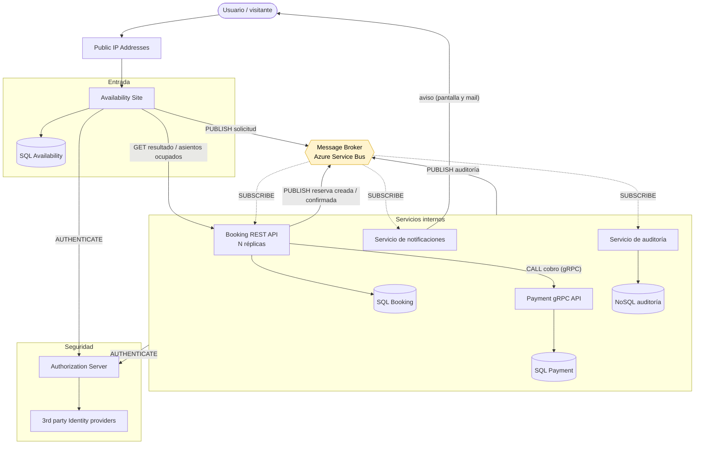
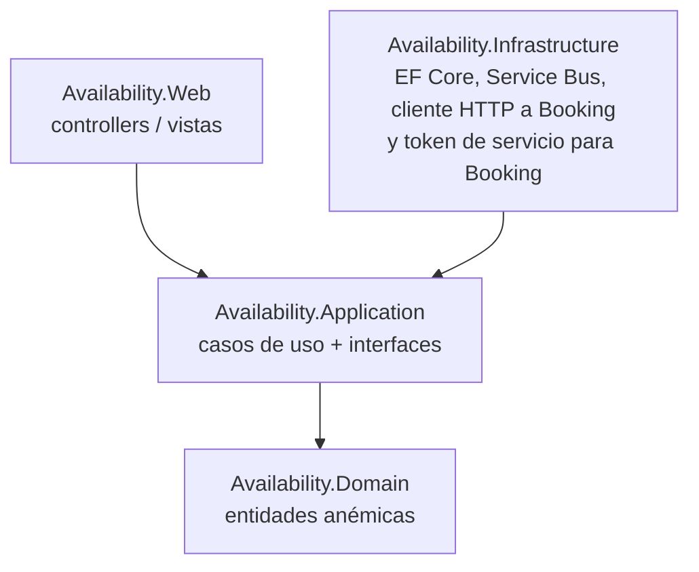
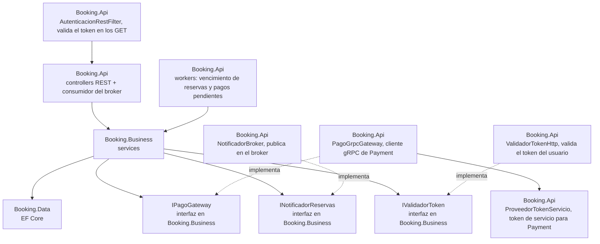
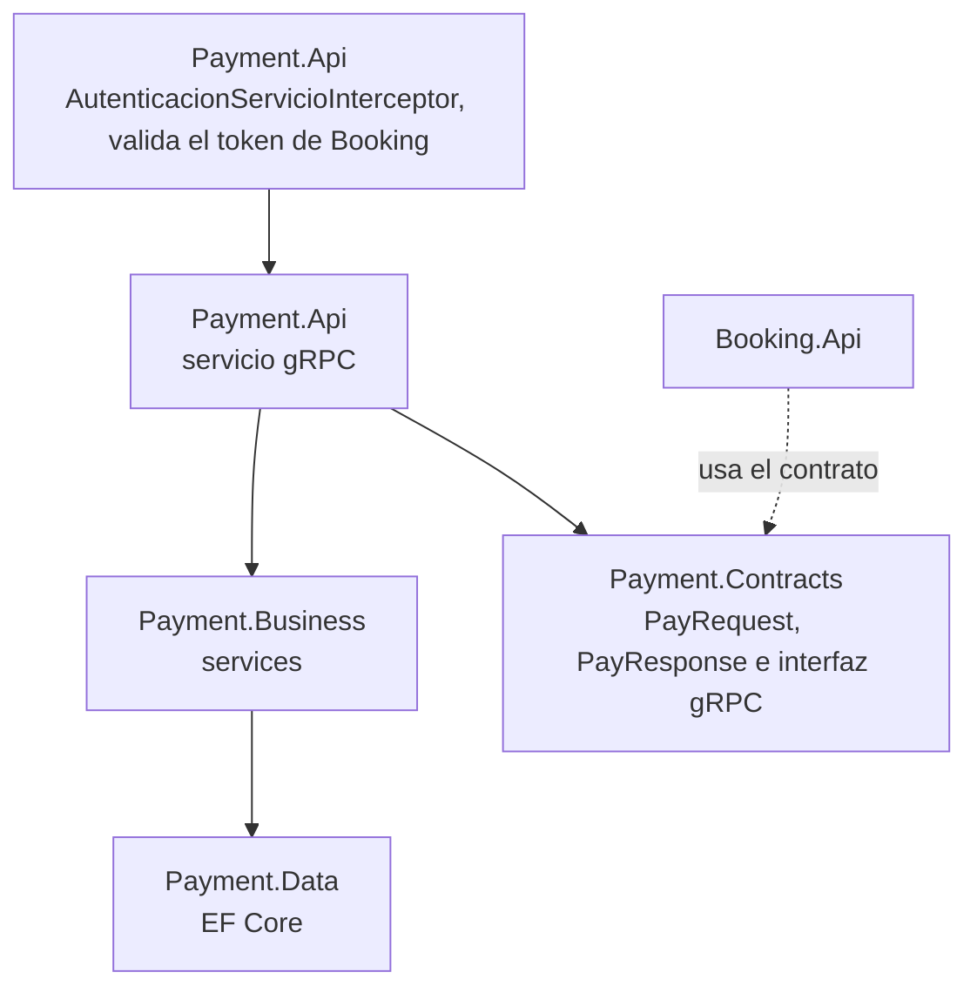
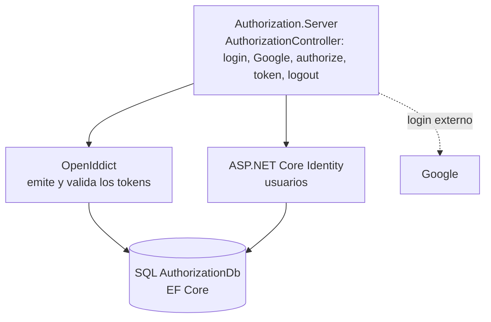
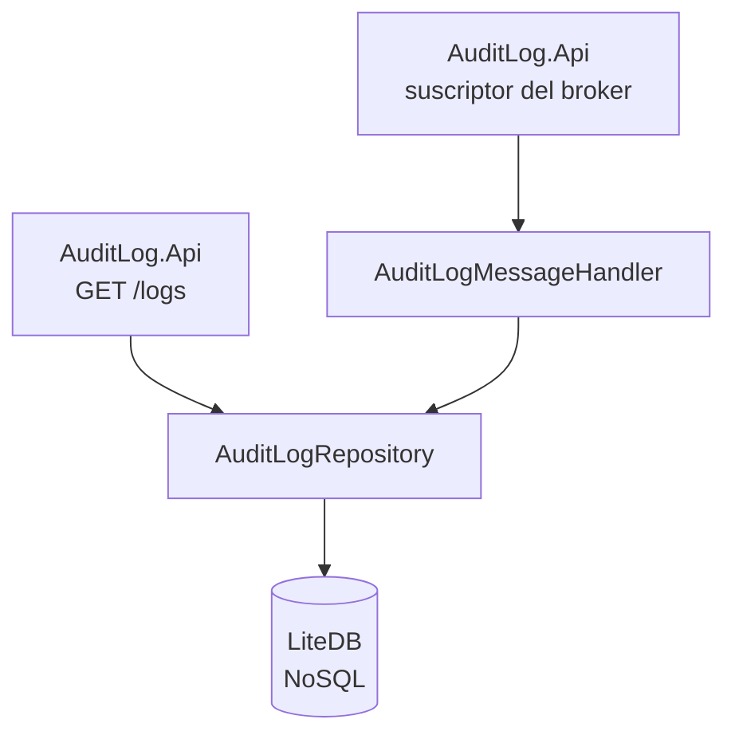
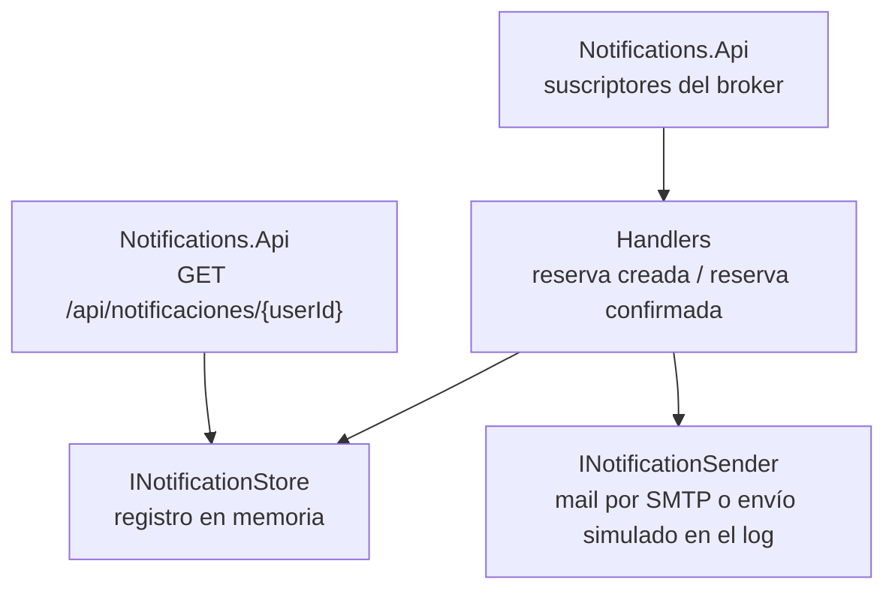

# Sistema de reserva de asientos - Grupo N° 9

Trabajo práctico de Programación IV. Sistema de reserva de asientos para eventos hecho con microservicios.

---

## Integrantes

| Integrante | Responsabilidad |
|---|---|
| Matias Huyema | Availability |
| Alex Palaversich | Availability |
| Maximiliano Diaz | Booking |
| Gianni Mozzi | Booking y servicio de notificaciones |
| Martin Alberto Negro Ruffino | Payment |
| Nicolás Salvador Ruiz Diaz | Authorization Server |
| Manuel Wald Katz | Message Broker |
| Alejandra Alcorta | Infraestructura e integración, y envío de mails del servicio de notificaciones (de prueba, con Mailpit) |

---

## Diagrama de arquitectura

Es el diagrama del enunciado con los dos agregados pedidos: el **servicio de notificaciones** (punto 3h) y la marca de **dónde el sistema se vuelve eventualmente consistente** (punto 3g, en amarillo). También suma el **servicio de auditoría**, que centraliza los logs de los microservicios.



Todos los servicios (Availability, Booking, Payment, Notificaciones y Authorization Server) publican sus registros de auditoría en el broker. En el diagrama se dibuja una sola flecha para no recargarlo.

**Consistencia eventual (3g):** el sistema se vuelve eventualmente consistente en el **Message Broker**. Cuando Availability publica la solicitud, responde "solicitud recibida" sin esperar el resultado. Durante ese lapso, Availability ya registró la solicitud pero Booking todavía no creó la reserva, y el estado real del asiento se conoce recién cuando una réplica de Booking procesa el mensaje. Lo mismo pasa con la notificación al usuario, que llega después de que Booking confirma la reserva, y con los registros de auditoría, que llegan al servicio de auditoría después de que ocurre cada suceso. Los asientos ocupados que muestra Availability también pueden estar un poco atrasados: los pide a Booking por GET, y Booking puede haber procesado una reserva nueva justo después. En términos del teorema CAP, el sistema es AP: prioriza la disponibilidad y la tolerancia al particionado, y la consistencia es eventual.

---

## Tabla de interpretación del diagrama (1)

| Componente | Rol | Justificación de la participación en el sistema |
|---|---|---|
| Public IP Addresses | Entrada desde Internet | Es por donde entran los usuarios. Solo Availability queda expuesto, el resto de los servicios es interno. |
| Availability Site | Sitio público (front) y entrada de las reservas | Muestra los eventos y asientos disponibles sin pedir login. Recibe la solicitud de reserva, verifica que el asiento exista, la guarda con un id único y la publica en el broker. Para el seguimiento le consulta el resultado a Booking. |
| Message Broker | Comunicación asíncrona entre servicios | Separa Availability de Booking. Availability puede responder enseguida y si Booking está caído o saturado los mensajes quedan en la cola. Las réplicas de Booking compiten por los mensajes. |
| Booking REST API | Dueño de las reservas | Decide si el asiento está libre, crea la reserva retenida, le pide el cobro a Payment y confirma o rechaza según la respuesta. También vence las reservas retenidas que no tuvieron resultado. Está pensado para correr en varias réplicas: todas leen de la misma suscripción del broker y cada mensaje lo procesa una sola (consumidores competidores). En la demo corre una. |
| Payment gRPC API | Cobro | Cobra las reservas retenidas. Usa gRPC porque es una llamada interna y sincrónica entre servicios, con contrato tipado y menos overhead que REST. |
| SQL Database (una por servicio) | Persistencia | Availability, Booking y Payment tienen cada uno su base (el Authorization Server también tiene la suya, AuthorizationDb). Así ningún servicio depende del esquema de otro y pueden evolucionar por separado (database per service). |
| Authorization Server | Autenticación y tokens | Emite los tokens que necesita el usuario para reservar. También autentica a los microservicios entre sí, así cada API solo acepta llamadas de clientes autorizados. |
| 3rd party Identity providers | Login externo | Permiten entrar con cuentas que el usuario ya tiene. En este TP está implementado Google. El Authorization Server delega el login en él y después emite sus propios tokens. |
| Servicio de notificaciones (agregado, 3h) | Avisos al usuario | Escucha el broker y le avisa al usuario cuando la reserva se creó y cuando quedó confirmada después del pago. Los avisos se ven en la página de estado de la reserva y también llegan por mail. Expone un GET para consultar los avisos de un usuario, que solo los entrega a su dueño (valida el token contra el Authorization Server). Si falla, la reserva sigue funcionando igual. |
| Servicio de auditoría (agregado) | Registro centralizado de sucesos | Recibe por el broker los registros de auditoría de los microservicios y los guarda en una base NoSQL, con el ID de correlación de cada reserva. Así se puede seguir una reserva de punta a punta en un solo lugar (punto 3f). Expone un GET administrativo para consultarlos. Si falla, los registros esperan en el broker y la reserva no se frena. |

---

## Arquitectura de cada API (3i)

### Availability: Clean Architecture, dominio anémico



Las dependencias apuntan siempre hacia adentro: `Domain` no depende de nadie y `Application` define interfaces que `Infrastructure` implementa.

### Booking: N-Layer, dominio anémico



Cada capa solo usa la de abajo: Api → Business → Data. Business define las interfaces de lo externo (`IPagoGateway`, `INotificadorReservas`, `IValidadorToken`, `IBookingAuditPublisher`) y Api las implementa, así Business no depende de gRPC, del broker ni del Authorization Server.

### Payment: N-Layer, dominio anémico



Cada capa solo usa la de abajo: Api → Business → Data. Payment.Contracts tiene el contrato gRPC y lo comparte con Booking, que lo usa para llamarlo. Antes de llegar al servicio, cada llamada pasa por un interceptor que exige el token de servicio de Booking (punto 3e). La auditoría sigue el mismo criterio: Business define `IPaymentAuditPublisher` y Api lo implementa publicando en el broker.

El detalle de Payment está en su [README](src/Payment/README.md).

### Authorization Server: un solo proyecto



Es un solo proyecto porque no tiene reglas de negocio propias: el protocolo (OAuth 2.0 y OpenID Connect) lo resuelve OpenIddict y los usuarios, Identity. El usuario obtiene su token con el flujo authorization code + PKCE, con el cliente `availability-web`, y puede entrar con usuario y contraseña o con Google.

El detalle de Authorization Server está en su [README](src/Authorization/Authorization.Server/README.md).

#### Autenticación entre servicios (3e)

Todos los servicios validan los tokens contra el mismo endpoint del Authorization Server, `GET /api/auth/validate`, que responde `200 { valid, subject, email }` si el token es válido y `401` si no. Ningún servicio valida tokens por su cuenta.

| Llamada | Token | Qué se valida |
|---|---|---|
| Availability → Booking (por el broker) | Del usuario, viaja en el mensaje | Que sea válido y que su `subject` sea el usuario de la solicitud (ver abajo). |
| Booking → Payment (gRPC) | De servicio, con client credentials | Booking lo pide a `/connect/token` con el cliente `booking-service` y lo reutiliza hasta poco antes de que venza. Payment lo valida en un interceptor y exige que sea de `booking-service`: sin token o vencido responde `Unauthenticated` (Booking pide uno nuevo y reintenta una vez) y de otro cliente, `PermissionDenied`. |
| Availability → Notificaciones (HTTP) | Del usuario, en `Authorization: Bearer` | Que sea válido (si no, `401`) y que el usuario pida sus propios avisos (si no, `403`). |
| Availability → Booking, estado de la solicitud (`GET solicitudes/{requestId}`) | Del usuario, en `Authorization: Bearer` | Que sea válido (si no, `401`) y que la reserva sea de ese usuario. Si es de otro, responde `404`, igual que si no existiera, para no revelar que ese id existe. |
| Availability → Booking, asientos ocupados (`GET eventos/{eventoId}/asientos-ocupados`) | De servicio, con client credentials | La pantalla de asientos es pública y puede no haber usuario, así que Availability pide su propio token con el cliente `availability-service` y lo reutiliza hasta poco antes de que venza. Booking exige que sea de ese cliente: sin token, `401`; con un token de usuario o de otro cliente, `403`. |

En Booking los dos GET pasan por un filtro (`AutenticacionRestFilter`) que valida el token antes de llegar al controller, con el mismo `IValidadorToken` que usa para los mensajes del broker.

Si el Authorization Server no responde, ningún servicio toma el token como inválido: Booking deja que el broker reentregue el mensaje (o responde `503` en sus GET), Payment responde `Unavailable` y Notificaciones, `503`.

#### Validación de identidad en la reserva (validación delegada)

1. El usuario inicia sesión en Availability.Web (OIDC contra el Authorization Server). El access token queda guardado en la sesión (`SaveTokens`).
2. Al confirmar una reserva, Availability.Web toma ese token y lo envía en el campo `AccessToken` de `ReservationRequestedMessage` (contrato en `Broker.Messaging`). No se guarda en la base de Availability.
3. Booking, antes de procesar el mensaje, llama a `GET {Auth:Authority}/api/auth/validate` con `Authorization: Bearer <token>`.
4. Booking exige que `subject` sea igual al `UserId` del mensaje. Si el token falta, es inválido, venció (dura 15 minutos) o es de otro usuario, la solicitud queda `Rechazada` con motivo `TokenInvalido` (visible en la pantalla de estado) y el mensaje no se reintenta.
5. Si el Authorization Server no responde, Booking no rechaza: deja que el broker reentregue el mensaje.

El token es un secreto: no se loguea. Mensajes sin `AccessToken` (versiones anteriores) se rechazan igual.

### Servicio de auditoría: un solo proyecto, dominio anémico



Es un solo proyecto porque no tiene reglas de negocio: guarda cada `AuditLogMessage` que llega por la suscripción `auditlog` y permite consultarlos. Usa LiteDB, una base NoSQL embebida que no necesita servidor, porque cada registro es un documento independiente y su campo `Details` cambia según el servicio que lo manda.

- El GET `/logs` filtra por ID de correlación, servicio, acción y fechas. Así se ve una reserva de punta a punta (punto 3f).
- Si el mismo registro llega dos veces, se guarda una sola vez: se identifica por su `LogId`.

El detalle del servicio de auditoría está en su [README](src/AuditLog/README.md).

### Servicio de notificaciones: un solo proyecto, dominio anémico



Es un solo proyecto (Notifications.Api) porque no tiene reglas de negocio: traduce cada aviso de Booking en una notificación al usuario.

| Aviso | Mensaje del broker | Suscripción |
|---|---|---|
| Reserva creada (Retenida) | `ReservationCreatedMessage` | `notificaciones-creada` |
| Reserva confirmada (pago exitoso) | `ReservationConfirmedMessage` | `notificaciones-confirmada` |

- Una suscripción por tipo de aviso: el suscriptor de la librería del broker descarta los mensajes que no son de su tipo, así que si compartieran suscripción cada uno se perdería los del otro.
- Si el broker entrega dos veces el mismo aviso, el usuario recibe uno solo: se registra por solicitud y tipo de aviso. El registro es en memoria y se pierde al reiniciar el servicio.
- El envío depende de la configuración: si hay un servidor SMTP (`Smtp:Host`), `EmailNotificationSender` manda un mail con MailKit; si no, `SimulatedNotificationSender` lo deja en el log de auditoría. Los handlers no cambian, solo la implementación de `INotificationSender` que se registra en `Program.cs`.
- En desarrollo el SMTP es [Mailpit](https://mailpit.axllent.org/): atrapa los mails sin mandarlos a internet y los muestra en http://localhost:8025. Los mails van a una casilla de demo (`demo@grupo9.local`), porque los mensajes del broker traen el id del usuario y no su mail.

---

## Demo (3j)

### Happy path

1. Levantar los servicios como se explica en [Cómo ejecutarlo](#cómo-ejecutarlo).
2. Entrar a https://localhost:7056 sin iniciar sesión: se ven los eventos y sus asientos disponibles.
3. Elegir un evento y un asiento libre. Para reservar, el sitio pide iniciar sesión: se puede usar el usuario de prueba **test@bombo.com / Test1234!** (se crea solo al arrancar el Authorization Server) o una cuenta de Google.
4. Confirmar la reserva. Availability responde enseguida que la solicitud fue recibida, sin esperar el resultado.
5. En la página de estado, tocar "Actualizar estado": la reserva pasa a **Retenida** y, cuando Payment aprueba el cobro, a **Confirmada**. Si se consulta apenas confirmada puede figurar **Pendiente**: Booking todavía no procesó el mensaje (es la consistencia eventual del 3g).
6. En la consola de Notifications.Api (con Docker: `docker compose logs notifications`) aparecen los dos avisos: reserva creada y reserva confirmada. También se ven en la página de estado de la reserva y, si está Mailpit, como mails en http://localhost:8025.

> **Los mails no llegan a la casilla real del usuario.** Son de prueba: Mailpit los atrapa en la propia compu y no salen a internet. Para verlos hay que abrir http://localhost:8025, aunque se haya iniciado sesión con una cuenta de Google.

Payment aprueba o rechaza el cobro al azar (mitad y mitad), así en la demo se ven los dos resultados sin cambiar ninguna configuración: **Confirmada** o **Rechazada** con motivo "pago fallido". Probando varias veces aparecen los dos.

### Fallo: falta un componente

1. Levantar todos los servicios menos Payment.Api. Con Docker: levantar todo y después `docker compose stop payment` (al terminar, `docker compose start payment`). En Visual Studio: dejar Payment.Api en "Ninguno" en los proyectos de inicio.
2. Reservar un asiento como en el happy path. Availability recibe la solicitud igual y la reserva queda **Retenida**.
3. Booking no puede cobrar y reintenta cada 15 segundos.
4. La retención dura 5 minutos. Cuando faltan 30 segundos para que venza, Booking rechaza la reserva con motivo **"pago no disponible"** y el asiento vuelve a estar libre.

Mientras Payment está caído, el resto del sistema sigue funcionando: se pueden ver asientos y mandar otras solicitudes.

### Logs de auditoría (3f)

Cada microservicio loguea el inicio y el fin de la cadena de sucesos con un ID de correlación. Para la reserva, ese ID es el de la solicitud (`RequestId`): lo genera Availability, viaja en los mensajes del broker y lo usan Booking y Notificaciones en sus registros, así se puede seguir una misma reserva entre los servicios. Payment registra cada cobro con un ID propio; en su registro de fin incluye el id de la reserva (`BookingId`) y del intento de pago, que es como se une con lo que registró Booking.

Ejemplo real de la consola de Notifications.Api para una reserva confirmada (el ID de correlación es el de la solicitud):

```
[AUDITORIA] RECIBIDO correlationId=ab1dbfb8-6159-4838-a155-9094b2037368 intento=1
[AUDITORIA] INICIO cadena correlationId=ab1dbfb8-6159-4838-a155-9094b2037368 publicando AuditLogMessage
[AUDITORIA] PUBLICADO correlationId=ab1dbfb8-6159-4838-a155-9094b2037368 AuditLogMessage en el broker
[AUDITORIA] NOTIFICACION enviada. correlationId=ab1dbfb8-6159-4838-a155-9094b2037368 tipo=ReservaConfirmada mensaje="Tu reserva del asiento 422 del evento 4 fue confirmada. Pago recibido: 35000,00."
[AUDITORIA] FIN correlationId=ab1dbfb8-6159-4838-a155-9094b2037368 procesado OK
```

Los mismos registros quedan en el servicio de auditoría: filtrando por ese ID de correlación en la consola de AuditLogs se ve la reserva en todos los servicios.

---

## Historial de prompts (punto 2)

| Integrante | Historial |
|---|---|
| Matias Huyema | [matiashuyema_prompts.md](prompts/matiashuyema_prompts.md) |
| Alex Palaversich | [Alex_Palaversich.md](prompts/Alex_Palaversich.md) |
| Maximiliano Diaz | [maximiliano_diaz_historial_prompts.md](prompts/maximiliano_diaz_historial_prompts.md) |
| Gianni Mozzi | [Gianni_Mozzi.md](prompts/Gianni_Mozzi.md) |
| Martin Alberto Negro Ruffino | [Martin_NegroRuffino.md](prompts/Martin_NegroRuffino.md) |
| Nicolás Salvador Ruiz Diaz | [nicolas_prompts.md](prompts/nicolas_prompts.md) |
| Manuel Wald Katz | [manuel_wald.md](prompts/manuel_wald.md) |
| Alejandra Alcorta | [Alejandra_Alcorta.md](prompts/Alejandra_Alcorta.md) |

Todos los historiales están en la carpeta [prompts](prompts/).

---

## Cómo ejecutarlo

Hay dos formas: con Visual Studio o con Docker.

### Con Visual Studio

**Requisitos:** Visual Studio 2026 (usamos la edición Community) con la carga de trabajo "Desarrollo de ASP.NET y web", que incluye el SDK de .NET 10 y SQL Server LocalDB.

1. Cargar la connection string del Service Bus en los User Secrets de Availability.Web, Booking.Api, Payment.Api, Notifications.Api, Authorization.Server y AuditLog.Api (en Visual Studio: clic derecho en el proyecto → "Administrar secretos de usuario"):
   `dotnet user-secrets set "Broker:ConnectionString" "<connection string>"`

   La connection string empieza con `Endpoint=sb://` y termina con `EntityPath=grupo9`. AuditLog.Api necesita además la contraseña de su consola: `dotnet user-secrets set "AuditLog:Password" "<contraseña>"`. Authorization.Server necesita las credenciales de Google, que se cargan como se explica en su [README](src/Authorization/Authorization.Server/README.md).
2. Tener SQL Server LocalDB, que viene con Visual Studio. Las bases (Availability, BookingDb, PaymentDb y AuthorizationDb) se crean solas al arrancar cada servicio. El servicio de auditoría usa LiteDB, un archivo local que tampoco hay que crear.
3. Levantar los servicios. En Visual Studio: clic derecho en la solución → "Configurar proyectos de inicio" → "Varios proyectos de inicio", y marcar Authorization.Server, Payment.Api, Booking.Api, Notifications.Api, AuditLog.Api y Availability.Web con la acción "Iniciar", en ese orden. Authorization Server (`https://localhost:7000`) debe estar levantado antes que los demás: Availability.Web inicia sesión contra él y Booking le valida el token de cada reserva.
4. Entrar a https://localhost:7056
5. Opcional, para ver los avisos como mails: levantar Mailpit con `docker run -d --name mailpit -p 1025:1025 -p 8025:8025 axllent/mailpit` y cargar en Notifications.Api `dotnet user-secrets set "Smtp:Host" "localhost"`. Los mails se ven en http://localhost:8025. Sin `Smtp:Host` el envío queda simulado en el log. Si el contenedor de Mailpit ya existe de antes, se prende con `docker start mailpit`. Si antes se levantó todo con Docker, correr `docker compose down` primero: usan los mismos puertos.

Puertos de cada servicio:

| Servicio | HTTPS | HTTP |
|---|---|---|
| Availability | 7056 | 5269 |
| Booking | 7125 | 5295 |
| Payment | 7154 | 5087 |
| Notificaciones | 7310 | 5310 |
| Authorization Server | 7000 | 7001 |
| Servicio de auditoría | - | 5305 |

Booking llama a Payment por gRPC en `http://localhost:5087`. Availability llama a Booking por HTTP en `http://localhost:5295`. Booking no redirige de HTTP a HTTPS a propósito: es una API interna y, al seguir una redirección, .NET descarta el header `Authorization`, así que el token no llegaría.

### Con Docker

**Requisitos:** Docker Desktop. No hace falta LocalDB: el compose levanta su propio SQL Server.

1. Copiar `.env.example` a `.env` en la raíz y completar `SERVICEBUS_CONNECTION_STRING`, `SA_PASSWORD` y `AUDITLOG_PASSWORD`. El `.env` no se sube al repo.
2. Desde la raíz, correr `docker compose up --build`.
3. Entrar a https://localhost:7056 (el navegador avisa por el certificado autofirmado: aceptarlo una vez, también en https://authorization.localtest.me:7000).

`authorization.localtest.me` es un dominio público que apunta a 127.0.0.1. Algunos routers no lo resuelven (el navegador muestra `DNS_PROBE_FINISHED_NXDOMAIN` al iniciar sesión). En ese caso, agregar esta línea al archivo hosts (`C:\Windows\System32\drivers\etc\hosts`, editándolo como administrador):

```
127.0.0.1 authorization.localtest.me
```

No levantar a la vez los servicios desde Visual Studio y con Docker: usan los mismos puertos y el segundo no arranca (`address already in use`).

Puertos: Availability `7056` (HTTPS), Authorization Server `7000` (HTTPS), Booking `5295`, Payment `5087`, Notificaciones `5310`, servicio de auditoría `5305` y Mailpit `8025` (mails de las notificaciones).

### Consola de AuditLogs

Ejecutar `docker compose up --build -d auditlog` y abrir http://localhost:5305. Ingresar con la contraseña definida en `AUDITLOG_PASSWORD` del `.env`. Compose la inyecta al iniciar el contenedor como `AuditLog__Password`; la contraseña no se incluye en la imagen ni en el JavaScript. Para cambiarla, editar el `.env` y volver a ejecutar el comando.

El front se sirve desde AuditLog.Api, sin instalar dependencias adicionales. Permite combinar filtros por servicio, acción, Correlation ID, Log ID y rango de fechas. Las coincidencias son exactas, las fechas se ingresan y muestran en hora local y se envían al GET en UTC. Cada página devuelve hasta 50 registros; si la última tiene exactamente 50, la siguiente puede estar vacía. Los detalles JSON se pueden desplegar en cada fila.

Al pulsar un encabezado se alterna el orden ascendente/descendente en el servidor antes de paginar. El GET `/logs` conserva sus filtros y agrega `sortBy=dateUtc|service|action|message|correlationId|logId` y `sortDirection=asc|desc`; por defecto devuelve los más recientes primero.

El login de ejemplo usa una contraseña compartida y una cookie HttpOnly de cuatro horas. `/logs` requiere sesión y devuelve 401 si no está autenticado. Para consumirlo desde otro cliente, hacer primero `POST /session` con JSON `{"password":"..."}` y conservar la cookie. `GET /session` consulta la sesión y `DELETE /session` la cierra. Sin contraseña configurada, el login devuelve 503.

Para ejecutar AuditLog fuera de Docker, definir `AuditLog__Password` en el entorno, además de la conexión al broker, y correr `dotnet run --project src/AuditLog/AuditLog.Api`.
